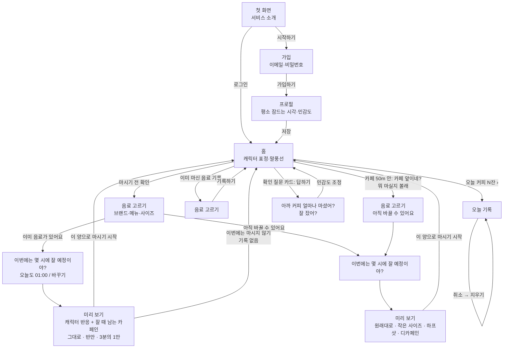

# 사용자 흐름과 화면 구성

`docs/problem.yaml`의 features(F1~F6)와 `docs/scenarios.yaml`의 흐름(S1~S7)을 한눈에 보기 위한 문서다. 용어 정의는 루트 `CONTEXT.md`를 따른다. 버튼·메뉴 이름은 scenarios.yaml과 같게 유지하고, 화면에서 이름을 바꾸면 세 문서를 같은 커밋에서 고친다.

## 1. 전체 흐름

## 2. 기능과 흐름 짝

| 기능 | 흐름 | 시작 상태 |
| --- | --- | --- |
| F1 가입과 프로필 | S1 | 로그인하지 않은 첫 화면 |
| F2 마시기 전 확인 | S2 반만 마시기, S3 마시지 않기 | 시드 계정 "학생" |
| F3 카페 앞 알림 | S4 카페 앞 하프샷 | 시드 계정, 등록된 카페 좌표 |
| F4 이미 마신 음료 기록 | S5 | 시드 계정 |
| F5 오늘 상태 | S6 기록 지우기 (S2~S7에서 표정·잔 수도 확인) | 시드 계정, 오늘 기록 1건 |
| F6 확인 질문 | S7 | 시드 계정, 어제 기록 "스타벅스 아이스 아메리카노 톨" + 못 잤다는 답 1번 |

## 3. 계산 규칙

- 남은 양 = 마신 양 × 0.5^(지난 시간 ÷ 반감기)
- 반감기: 둔한 편 3.5시간, 보통 5시간, 민감한 편 7시간 (출처는 problem.yaml sources R8·R9)
- 잘 때 남는 카페인 구간: 30mg 아래 "잠에 거의 영향 없음" / 30~100mg "조금 늦게 잠들 수 있음" / 100mg 이상 "많이 남음". 캐릭터 표정 3단계와 같다
- 추천 양: 잘 때 남는 카페인이 100mg 아래에 머무는 가장 큰 양을 다 / 반 / 3분의 1 / 오늘은 여기까지 중에서 고른다 (100mg은 [가설])
- 민감도 조정: 확인 질문에서 예측보다 못 잤다는 답이 2번 쌓이면 한 단계 올리고, 잘 잤다는 답이 2번 쌓이면 한 단계 내린다

## 4. 만들지 않는 것

건강 앱 수면 데이터 연동(웹앱에서는 읽을 수 없음), 앱이 닫혀 있을 때의 위치 추적과 푸시 알림, 진단 기능, 커피를 끊게 하는 기능, 흡연·복용약 질문, 상세 수면 통계.
